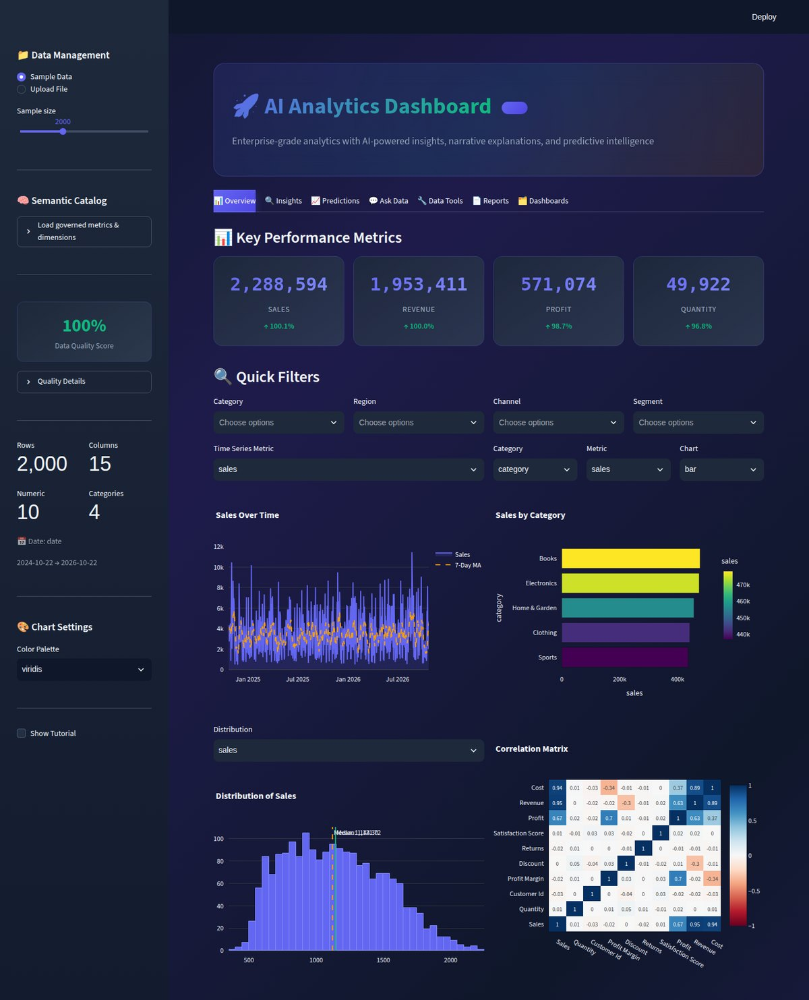
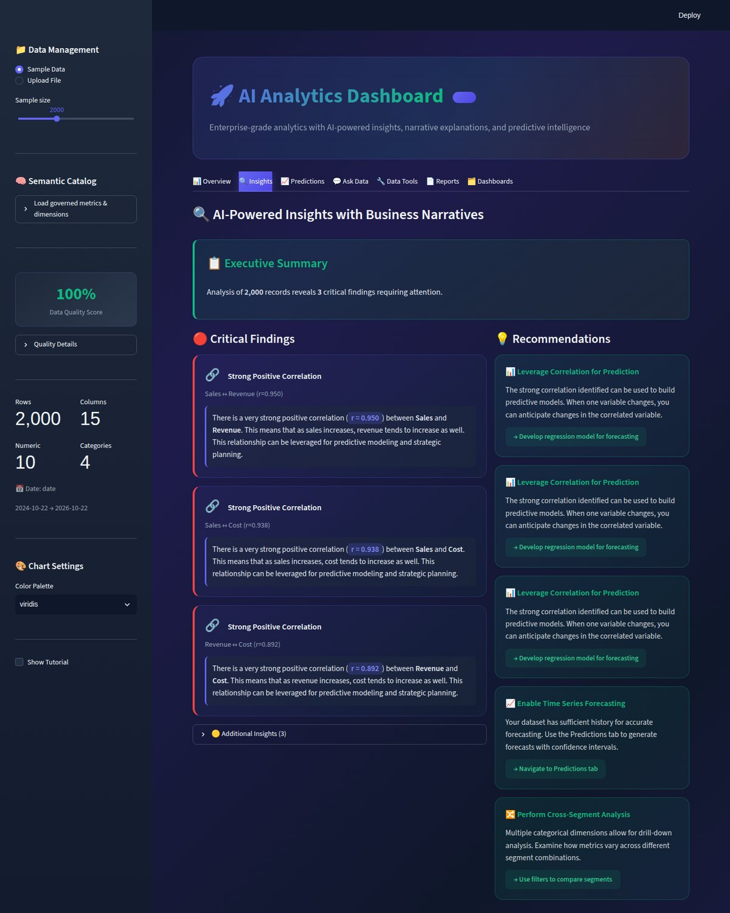
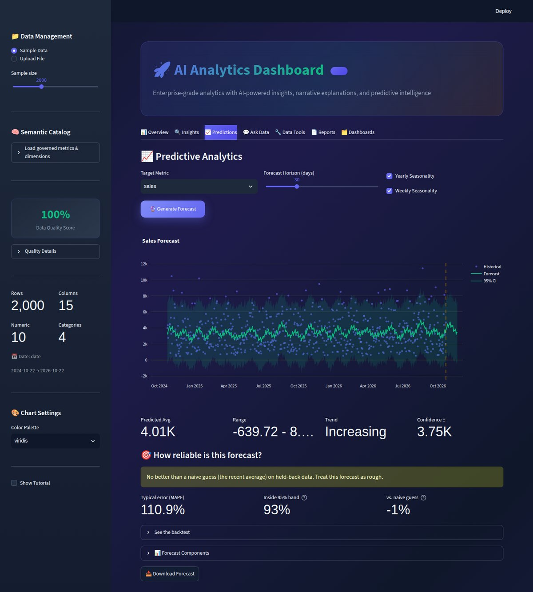
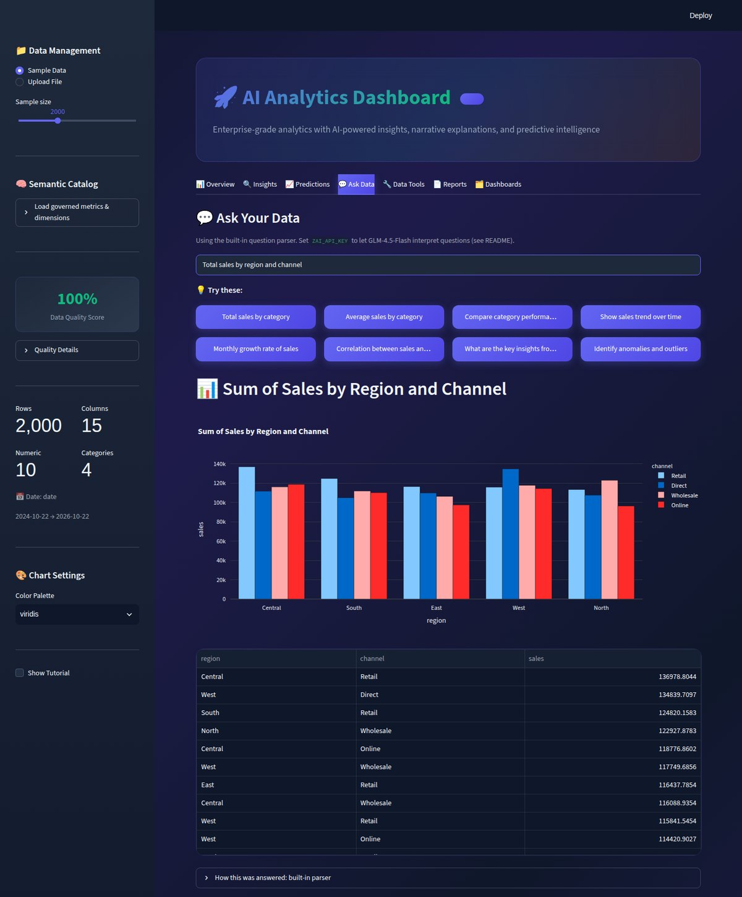
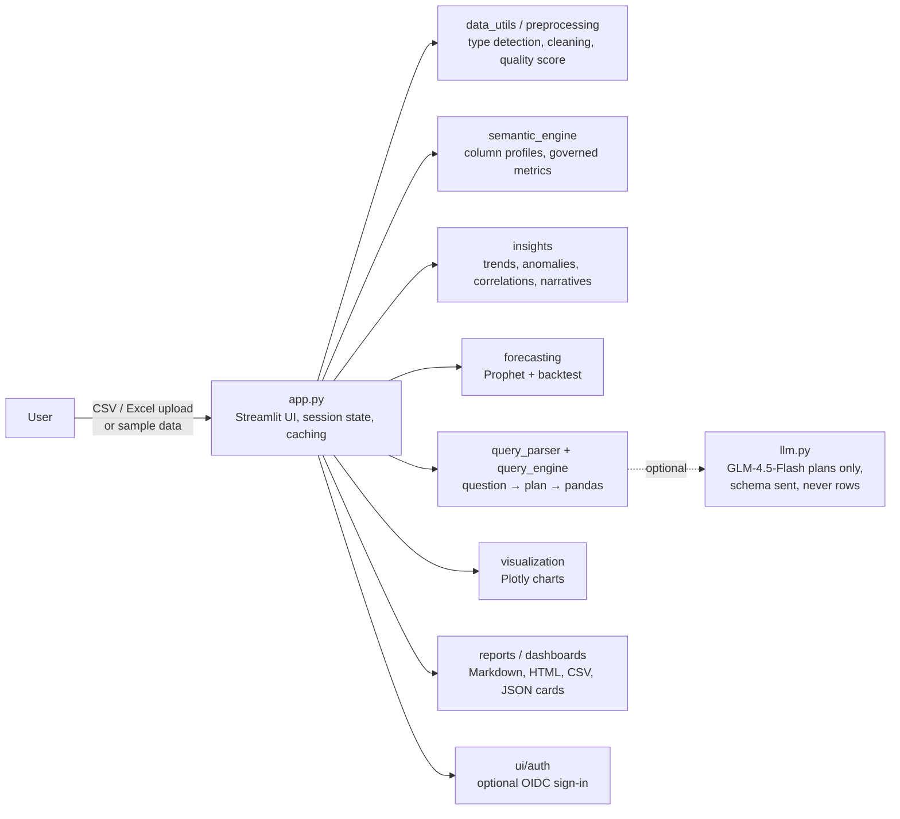

# AI Analytics Dashboard

**Upload a CSV or Excel file and get automated insights, anomaly detection, Prophet forecasts and plain-English answers to your questions, in one self-hosted Streamlit app.**

[](https://github.com/Akshatb848/AI-Analytics-Dashboard/actions/workflows/ci.yml)
[](LICENSE)




<sub>Screenshot of the app running locally on its built-in synthetic sample dataset (2,000 rows). Numbers shown are from that generated data, not from a real business.</sub>

<details>
<summary><b>More screenshots</b> (Insights, Predictions, Ask Data)</summary>

| Automated insights | Prophet forecast with backtest |
|---|---|
|  |  |

**Ask Data:** "Total sales by region and channel", answered by the built-in parser (no API key)



</details>

---

## Key features

- **Automated insights.** Trend, correlation, IQR-based anomaly, distribution, category-performance, seasonality and statistical-test checks, each written up as a short business narrative with recommendations.
- **Forecasting.** Prophet forecasts for any numeric column with configurable horizon and seasonality, a 95% interval, component plots, and a hold-out **backtest** that reports MAPE, interval coverage and a comparison against a naive baseline, so you can tell when a forecast is not worth trusting.
- **Ask Data (natural-language queries).** Totals, averages, counts, top/bottom N, one or two groupings, filters by category/number/year, trends by day to year, correlations, distributions and outliers, each answered with a chart, a table and an explanation. A rule-based parser works offline; optionally **GLM-4.5-Flash** (Z.ai) turns freer phrasing into a validated query plan.
- **Semantic catalog.** Load a JSON catalog of governed metrics, dimensions and time grains so KPIs mean the same thing everywhere, with validation against your columns.
- **Data Tools.** Missing-value handling, outlier treatment and date-feature extraction, plus a data-quality score.
- **Dashboards and reports.** Save answers as dashboard cards, export/import them as JSON, and download Markdown, HTML or CSV reports.
- **Optional sign-in.** Streamlit's built-in OpenID Connect (Google, Entra ID, Auth0, Okta, ...) with email or domain allow-lists.

## Architecture



When GLM is enabled, the model only proposes a query plan (columns, filters, grouping, aggregation). The app validates that plan against your schema and executes it with pandas; the model never runs code. Z.ai receives the question, column names and types, up to 15 values per category column and the date range, never the data rows. If the key is missing, the API fails, or the reply can't be used, the built-in parser answers and the app says so.

## Tech stack

| Area | Tools |
|---|---|
| App / UI | Streamlit 1.64 |
| Data | pandas, NumPy, openpyxl |
| Statistics | SciPy, statsmodels |
| Forecasting | Prophet |
| Charts | Plotly |
| Optional LLM | GLM-4.5-Flash via Z.ai HTTP API (`requests`) |
| Auth (optional) | Streamlit OIDC (Authlib) |
| Quality | pytest (Streamlit `AppTest`), Ruff, GitHub Actions, Docker health check |

## Quick start

### Local

```bash
git clone https://github.com/Akshatb848/AI-Analytics-Dashboard.git
cd AI-Analytics-Dashboard
python -m venv .venv && source .venv/bin/activate   # Windows: .venv\Scripts\activate
pip install -r requirements.txt                      # pinned; needs Python 3.11+
streamlit run app.py
```

Open http://localhost:8501. The app starts on a generated sample dataset; switch to **Upload File** in the sidebar for your own CSV/XLSX (50 MB limit via `.streamlit/config.toml`).

### Docker

```bash
docker build -t ai-analytics-dashboard .
docker run -d -p 8501:8501 --env-file .env ai-analytics-dashboard
```

The image runs as a non-root user and has a health check on Streamlit's `/_stcore/health` endpoint. Secrets are excluded by `.dockerignore`; pass them at runtime. A `Procfile` is included for Heroku/Railway-style hosts, and the app also deploys as-is to Streamlit Community Cloud (main file `app.py`).

## Configuration

Copy `.env.example` to `.env`. Every variable is optional.

| Variable | Purpose | Default |
|---|---|---|
| `ZAI_API_KEY` | Enables GLM-4.5-Flash for Ask Data | not set (built-in parser) |
| `ZAI_MODEL` | Model name | `glm-4.5-flash` |
| `ZAI_BASE_URL` | API base URL (GLM Coding Plan keys use `https://api.z.ai/api/coding/paas/v4`) | `https://api.z.ai/api/paas/v4` |
| `MAX_UPLOAD_ROWS` | Rows read from an upload; larger files are truncated with a warning | `200000` |
| `ALLOWED_EMAIL_DOMAINS` / `ALLOWED_EMAILS` | Sign-in allow-lists (comma-separated) | not set |

The same keys can go in `.streamlit/secrets.toml` (git-ignored) or Streamlit Cloud's Secrets settings.

<details>
<summary><b>Enabling sign-in (OIDC)</b></summary>

Without configuration, anyone who can reach the app can use it. Add an `[auth]` section to `.streamlit/secrets.toml`, for example for Google:

```toml
[auth]
redirect_uri = "http://localhost:8501/oauth2callback"
cookie_secret = "a-long-random-string"   # python -c "import secrets; print(secrets.token_hex(32))"
client_id = "your-client-id.apps.googleusercontent.com"
client_secret = "your-client-secret"
server_metadata_url = "https://accounts.google.com/.well-known/openid-configuration"

ALLOWED_EMAIL_DOMAINS = "yourcompany.com"
```

Visitors then see a sign-in page first; signed-in users get a **Sign out** button. Without an allow-list anyone who can sign in with the provider gets access, so set one for private data. With Docker, mount the file at runtime: `-v "$PWD/.streamlit/secrets.toml:/app/.streamlit/secrets.toml:ro"`.
</details>

## Testing

```bash
pip install -r requirements-dev.txt
ruff check .
pytest
```

The suite (140 tests) drives the real app headlessly with Streamlit's `AppTest` (sample data, Ask Data queries, forecasting, Data Tools, dashboards, sign-in) and unit-tests the query parser, LLM planner validation, dashboard import/export and data helpers. CI runs Ruff, pytest, and a Docker build that waits for the container to report healthy, on every push to `main` and every pull request.

## Project structure

```
├── app.py                 # Streamlit page: layout, tabs, session state, caching
├── analytics/
│   ├── data_utils.py      # Type detection, cleaning, quality score, sample data
│   ├── preprocessing.py   # Data Tools (missing values, outliers, date features)
│   ├── insights.py        # Automated insights and narratives
│   ├── query_parser.py    # Question → intent (rule-based)
│   ├── query_engine.py    # Executes intents with pandas, builds charts/answers
│   ├── llm.py             # Optional GLM client and query-plan validation
│   ├── forecasting.py     # Prophet forecasts and backtest
│   ├── visualization.py   # Overview charts
│   ├── dashboards.py      # Dashboard card export/import (JSON)
│   ├── reports.py         # Markdown / HTML / CSV reports
│   └── formatting.py      # HTML escaping and number formatting
├── ui/                    # CSS, tutorial, OIDC sign-in gate
├── semantic_engine.py     # Column profiling and semantic catalog
├── tests/                 # AppTest smoke tests and unit tests
├── docs/screenshots/      # README images
├── .streamlit/config.toml # Theme and upload limit
├── Dockerfile, Procfile
├── requirements.txt       # Pinned runtime dependencies
└── requirements-dev.txt   # pytest, ruff
```

## Limitations

- Everything runs in memory in a single Streamlit process; it's meant for moderately sized files (uploads are capped at 50 MB and `MAX_UPLOAD_ROWS`), not as a data warehouse front end.
- The rule-based Ask Data parser covers the query shapes listed above; free-form or multi-step questions need the optional GLM key, and even then answers are limited to what a single validated pandas plan can express.
- "Insights" are statistical heuristics (correlation, IQR outliers, period-over-period change); they flag patterns, not causes.
- Forecast quality depends entirely on your history; the backtest panel is there to show when a forecast is no better than a naive guess (as it is on the random sample data in the screenshot).
- Saved dashboards are exported/imported as JSON files; there is no shared database or multi-user workspace.

## License

[MIT](LICENSE) © 2026 Akshat Banga

## Author

**Akshat Banga** · [github.com/Akshatb848](https://github.com/Akshatb848)
